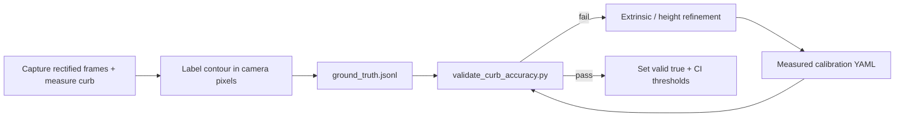

# PR5 — Calibration and accuracy validation

PR1–PR4 delivered overlay robustness and a **fail-closed** metric path. PR5 is where distances become **trustworthy**: measured camera geometry, labelled validation footage, and quantified error against ground truth.

## Goals

| Goal | Outcome |
|------|---------|
| Measured calibration | `config/calibration/<vehicle-profile>/*.yaml` with `valid: true` |
| Repeatable ground truth | JSONL datasets under `config/calibration/validation/` |
| Offline accuracy gate | `tools/validate_curb_accuracy.py` → MAE, max error, pass rate |
| Live regression (optional) | Extend `tools/verify_vision_metric_e2e.py` with distance checks when GT stream exists |
| No false claims | AI/synthetic footage stays `calibrationStatus: UNVERIFIED` / `distanceValid: false` in production |

## Prerequisites (vehicle / lab team)

See `docs/PR1_CALIBRATION_AUDIT.md` §6 and `config/calibration/README.md`.

1. **Intrinsics** on rectified 640×360 (pinhole K after Java `FisheyeUndistorter` 90° output, or measured on that image).
2. **Extrinsics** camera centre `t_m` and rotation camera→vehicle (rear axle: +x forward, +y left, +z up).
3. **Distance definition** — document reference (e.g. lateral body edge to curb lip); align with `vehicle_frame.yaml`.
4. **Rear camera** — separate YAML; rear pipeline geometry differs from side fisheye undistort.

## Phase workflow



### Step 1 — Calibration profile

Create e.g. `config/calibration/measured-golf-r/` (copy layout from `default/`), fill fx/fy/cx/cy and extrinsics, keep `valid: false` until Step 4 passes.

```yaml
# vision/config.yaml or env
calibration:
  profile: measured-golf-r
  allow_synthetic: false
```

### Step 2 — Ground truth dataset

Follow `config/calibration/validation/README.md`. Each sample needs:

- `contour_camera_pixels` from the **same** rectified image the NN sees
- `distance_m` from an independent measurement
- `tolerance_m` reflecting measurement uncertainty (typical 0.10–0.20 m for tape; tighter for survey)

### Step 3 — Run validator

```bash
python3 tools/validate_curb_accuracy.py \
  --profile measured-golf-r \
  --ground-truth config/calibration/validation/parking_lot_v1.jsonl \
  --min-pass-rate 0.85 \
  --max-mae-m 0.18 \
  --report artifacts/curb_accuracy_parking_v1.json
```

Pipeline self-test (no field data):

```bash
python3 tools/validate_curb_accuracy.py \
  --profile synthetic-dev \
  --ground-truth config/calibration/validation/ground_truth.synthetic_selftest.jsonl \
  --allow-synthetic
```

### Step 4 — Acceptance criteria (starting point)

Tune with your safety team; these are engineering defaults:

| Metric | Suggested gate |
|--------|----------------|
| Per-sample | `\|estimated − measured\| ≤ tolerance_m` |
| Dataset pass rate | ≥ 85% on hold-out clips |
| MAE | ≤ 0.18 m on hold-out (urban parking) |
| Max error | Investigate any sample > 0.35 m |

Overlay alignment (PR4) and distance accuracy (PR5) are **independent**: a aligned magenta line can still be metric-wrong if extrinsics are off.

### Step 5 — Production enablement

Only after gates pass on **measured** data:

1. Set per-camera `valid: true` in the measured profile.
2. Run vision with `mode: both`, `distance.require_valid_calibration: true`, `allow_synthetic: false`.
3. Add the validator to CI with your frozen `ground_truth.*.jsonl` subset (regression).

## What PR5 does not include

- Replacing the curb segmentation model (unless accuracy work proves NN is the bottleneck).
- Steering / UDP changes.
- Using unverified AI video as ground truth.

## Related code

| Path | Role |
|------|------|
| `vision/accuracy_validation.py` | Load JSONL, run estimator, build report |
| `tools/validate_curb_accuracy.py` | CLI |
| `vision/calibration_loader.py` | YAML profiles |
| `vision/curb_distance_estimator.py` | Ground-plane distance |
| `config/calibration/validation/` | Datasets + README |
